# 03 — Entity Relationship Diagram

Core entity relationships (full column lists are in `sql/schema.sql`).
Reference/config tables (`tbl_SystemParameter`, `tbl_RegulatoryRules`,
`tbl_ExcelTemplate`, `tbl_Target`, `tbl_Forecast`, `tbl_KPIResult`,
`tbl_DashboardParameter`) and the audit trail are omitted from the diagram
for readability — they relate to *every* other table via `RecordID`/
`AccountID`, not just the ones shown.

```mermaid
erDiagram
    Customer ||--o{ Facility : "has"
    Facility ||--o{ Account : "has"
    Customer ||--o{ Account : "has"
    Branch ||--o{ Account : "hosts"
    Employee ||--o{ Account : "assigned to"
    ExternalOffice ||--o{ Account : "assigned to"
    Employee ||--o{ Team : "manages"
    Department ||--o{ Team : "contains"
    Team ||--o{ Employee : "employs"

    Account ||--o{ Assignment : "history"
    Account ||--o{ MonthlySnapshot : "monthly"
    Account ||--o{ Movement : "monthly"
    Movement ||--o{ MovementException : "raises"

    Account ||--o{ Collection : "receives"
    Collection ||--o{ CollectionAllocation : "waterfall"
    Collection ||--o{ RecoveryCost : "incurs"
    Account ||--o{ Waiver : "has"

    Account ||--o{ Settlement : "has"
    Settlement ||--o{ SettlementPayment : "schedule"

    Account ||--o{ LegalCase : "has"
    LegalCase ||--o{ LegalAction : "has"
    LegalCase ||--o{ LegalNote : "has"
    ExternalOffice ||--o{ LegalCase : "handles"

    Account ||--o{ Collateral : "secured by"
    Collateral ||--o{ CollateralValuation : "revalued"
    Collateral ||--o{ CollateralConsumption : "consumed monthly"

    Account ||--o{ ProvisionSnapshot : "monthly"
    Account ||--o{ SuspendedInterest : "monthly"
    Account ||--o{ OffBalance : "0..1"
    Account ||--o{ WriteOff : "0..1"
    WriteOff ||--o{ PostWriteOffRecovery : "post-WO recovery"

    Account ||--o{ AccountNote : "has"
    Account ||--o{ FollowUp : "has"
    Account ||--o{ Promise : "has"

    Collection }o--o| Approval : "manual entries require"
    Waiver }o--o| Approval : "requires"
    Settlement }o--o| Approval : "requires"
    WriteOff }o--o| Approval : "requires"
    OffBalance }o--o| Approval : "requires"
    Account ||--o{ RegulatoryException : "6-year escalation"

    Account ||--o{ IFRS9Snapshot : "monthly"

    ImportBatch ||--o{ ImportFile : "contains"
    ImportFile ||--o{ ImportError : "may have"
    ImportBatch ||--o{ MonthlySnapshot : "produced"
    ImportBatch ||--o{ DataQuality : "scored"
```



## Data lineage keys

Every figure surfaced on a dashboard must be traceable back to source:

```
tbl_KPIResult.KPIValue
   → (query definition referenced by KPICode, see 06_REPORTS_AND_DASHBOARDS.md)
   → tbl_MonthlySnapshot / tbl_Collection / tbl_ProvisionSnapshot ...
   → tbl_MonthlySnapshot.BatchID / tbl_Collection.BatchID
   → tbl_ImportBatch → tbl_ImportFile.FileName + FileHash
   → original Excel row (RowNumber recorded in stg_* / tbl_ImportError)
```

`FileHash` (SHA-256 of the file bytes) is the duplicate-import guard:
`tbl_ImportFile.FileHash` is UNIQUE, so re-dropping the same file into
`Incoming\` is rejected before any row is staged.
